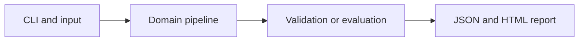

# Control-Anchored Assay Quality Monitoring

Detect artificial assay outliers after correcting plate offsets with explicit reference controls.

**Category:** Biology / Anomaly Detection

**Execution:** Actual local algorithm or workflow; no external model service required.

## Run

```sh
python -m venv .venv
# Windows: .venv\Scripts\activate
# macOS/Linux: source .venv/bin/activate
python -m pip install -r requirements.txt
python app.py
python -m unittest discover -v
```

Open `results/report.html` after running. Python 3.10+ is required. Use `--help` for input and seed options.

## Architecture



## Algorithm

Estimate each plate offset using designated controls. Learn a median and MAD-based feature scale from corrected training wells. Score a well by its maximum robust standardized deviation and choose a threshold from a separate normal validation plate.

## Evaluation

Test on a held-out plate containing injected anomalies, keeping anomaly labels outside fitting and threshold selection. Compare with an always-normal baseline.

## Limitations

The readouts and anomalies are mathematical fixtures. Control wells are assumed reliable; missing or contaminated controls invalidate the correction.

## Documentation

- [PDF project guide](PROJECT_GUIDE.pdf)
- [Editable guide](GUIDE.md)
- [Model and system card](MODEL_CARD.md)
- [Measured results](results/metrics.json)
- [Test output](TEST_RESULTS.txt)

## Extend it

Add multivariate covariance methods, control-failure checks, plate drift diagnostics and a licensed assay-QC benchmark.

AI-assisted educational project with synthetic data. Review, customize and explain your own contribution accurately. MIT license.

## Biology scope and current relevance

Default inputs are synthetic or project-authored. No clinical deployment or wet-lab validation is claimed. See [research context](RESEARCH_CONTEXT.md) and [data provenance](DATA_PROVENANCE.md).

- [Robust metabolomics normalization across experimental designs](https://pubs.acs.org/doi/10.1021/acs.analchem.5c06841) (2026)
